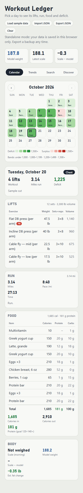
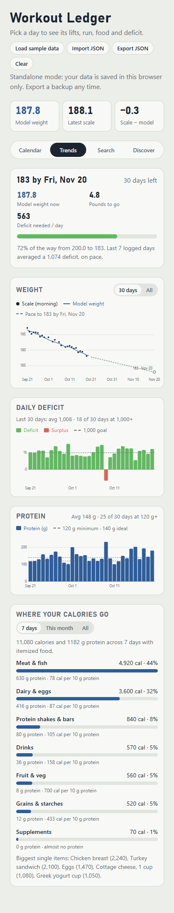
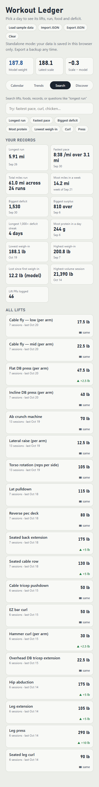

# Workout Ledger

A single-file fitness dashboard for a cut: a calendar shaded by daily calorie deficit, lifting sessions with automatic PRs, runs, a food log with calories/protein/carbs, a **model-vs-scale weight chart**, trends, and a searchable exercise history.

**Try it: https://dhuberportfolio.github.io/workout-ledger/**. Click **Load sample data** to see it with 45 days filled in. It runs in your browser, and your data stays there.

No build step, no server, no dependencies — just `index.html`.





*Screenshots use the generated sample data (`node scripts/screenshots.js` remakes them).*

## Run it

- **Locally:** open `index.html` in a browser, click **Load sample data** (or **Import JSON** with your own file).
- **GitHub Pages:** push this folder to a repo → Settings → Pages → *Deploy from a branch* → `main` / root. Your site is `https://<user>.github.io/<repo>/`.

In standalone mode your data stays in your browser's `localStorage`, and the page loads nothing from other sites (it uses fonts already on your device). Use **Export JSON** for backups.

**Import JSON** checks the whole file before it changes anything. A file with a problem (a day without a date, an exercise without a name, a word where a number goes) is refused with a list of what's wrong, and your saved data stays as it was. A good file replaces what's saved only after you confirm.

## Two storage modes

The page talks to storage through one small API (`collection(name).onSnapshot(fn)`, `.doc(id).set(v)`, `.delete()`):

1. **Standalone** (default): a localStorage-backed implementation in `index.html` with sample/import/export/clear buttons.
2. **Hosted with a shared DB:** if `window.claude.use('db')` exists (a claude.ai artifact), it uses that database instead, so an assistant can log days/lifts/runs and the page updates live. Swap in Firebase/Supabase the same way.

In either mode, a saved entry with a problem doesn't break the page: it's shown without the bad part, and a note under the header says what was skipped.

## Settings

Edit `DEFAULT_CONFIG` near the top of the script, or put a `config` object in your imported JSON:

```js
{ goalWeight: 180, goalDate: '2026-11-06', deficitGoal: 1000,
  proteinMin: 120, proteinIdeal: 140, calorieCap: 1800,
  foodWords: { Sweets: ['froyo'], 'Late night': ['midnight snack'] } }
```

`goalDate: null` means 30 days from today.

`foodWords` sorts your own foods in **Where your calories go**. Each food goes in the first group with one of its words. Your words are checked before the built-in groups (supplements, protein shakes & bars, sweets, drinks, meat & fish, takeout & fast food, dairy & eggs, grains & starches, fruit & veg, snacks, sauces & dips), and a name that isn't one of those starts a new group. Keeping brand or local names in your own config keeps them out of the code.

## Data format

```jsonc
{
  "days": {
    "2026-10-01": {
      "date": "2026-10-01", "phase": "Cut",
      "weight": 190.2,          // scale reading, optional
      "anchor": true,           // optional: reset the model to this weight
      "calIn": 1450, "calOut": 2500,
      "protein": 130, "carbs": 120,
      "food": [{ "item": "Greek yogurt", "cal": 170, "protein": 20, "carbs": 9 }],
      "workout": "Chest", "notes": ""
    }
  },
  "sessions": {
    "2026-10-01": { "date": "2026-10-01", "focus": "Chest",
      "exercises": [{ "name": "Incline DB press", "weight": 40, "sets": 3, "reps": 10 }] }
  },
  "runs": {
    "2026-10-01": { "date": "2026-10-01", "miles": 3.1, "pace": "9:34", "type": "Run", "note": "" }
  },
  "tryList": {},
  "config": { "goalWeight": 180 }
}
```

Collections may also be arrays of docs; ids default to `date`. See `sample-data.json`.

- Every day, session and run needs a `date` like `2026-10-01` (when the id is a date, it can stand in).
- A day can have several runs: in an array, runs that share a date are all kept (ids `2026-10-01`, `2026-10-01-2`, …). A day or session listed twice is an error.
- Every exercise needs a `name` and every food row an `item`. Number fields take numbers; text such as `"190.5"` is read as a number.
- Lift names are matched without regard to capitals or extra spaces, so "EZ bar curl" and "EZ Bar Curl" share one history. A PR is a session's top weight for a lift, when it beats every earlier session.

## Model weight

Scale weight is noisy (water, sodium, glycogen). The ledger also plots a **model weight**:

```
model[day] = model[day-1] − (calOut[day-1] − calIn[day-1]) / 3500
```

starting from the first logged scale weight. Any day marked `"anchor": true` resets the model to that day's scale reading. When the scale sits above the model for a few days and then drops back, that's water — the model shows the trend you've actually earned.

## Tests

```
npm install
npm test
```

The tests open `index.html` in [jsdom](https://github.com/jsdom/jsdom), a browser simulated in Node, and use the page the way a person would: its buttons, its storage and what it shows. Setting `LEDGER_HTML` to another copy of the page runs the same tests against that copy. That's how each test was first seen failing on the version before its fix.

## License

MIT
